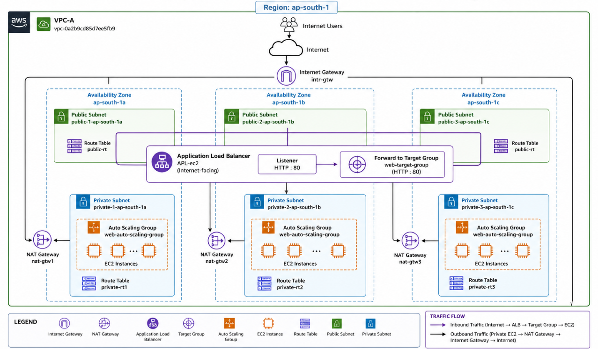

# AWS Production Architecture

## Project Overview

This hands-on project demonstrates a production-style AWS infrastructure using a custom Virtual Private Cloud (VPC), public and private subnets, an Application Load Balancer, EC2 instances, and an Auto Scaling Group.

The project focuses on cloud networking, traffic distribution, backend instance management, and high availability across multiple Availability Zones.

## Architecture

## AWS Services Used

- Amazon VPC
- Amazon EC2
- EC2 Launch Template
- Application Load Balancer (ALB)
- Target Group
- Auto Scaling Group
- Internet Gateway
- NAT Gateways
- Route Tables
- Security Groups

## Network Configuration

| Component | Configuration |
|---|---|
| AWS Region | Asia Pacific (Mumbai) — `ap-south-1` |
| VPC Name | `VPC-A` |
| Availability Zones | `ap-south-1a`, `ap-south-1b`, `ap-south-1c` |
| Public Subnets | 3 |
| Private Subnets | 3 |
| Custom Route Tables | 4 |
| NAT Gateways | 3 created; verify current status |
| Load Balancer | `APL-ec2` |
| Target Group | `web-target-group` |
| Launch Template | `web-template` |
| Auto Scaling Group | `web-auto-scaling-group` |

## Request Flow

Internet Users → Internet Gateway → Application Load Balancer → Listener → Target Group → EC2 Instances

The Application Load Balancer distributes incoming application requests to registered healthy targets.

## Private Subnet Connectivity

Private EC2 instances can use their associated private route tables and NAT Gateways for outbound Internet access, subject to the configured routes and security rules.

## Project Documentation

The complete project report is available here:

[View the Project Report](docs/Project-ALB.pdf)

## Testing and Validation

The project report documents the available AWS configuration and application evidence. Load balancing, automatic scaling, failure recovery, and private outbound connectivity should be marked as successfully tested only when supported by actual test evidence.

## Learning Outcomes

- AWS VPC and subnet design
- Public and private network routing
- Internet Gateway and NAT Gateway concepts
- Security Group configuration
- Application Load Balancer and Target Group integration
- EC2 Launch Templates and Auto Scaling
- Infrastructure documentation and validation

## Disclaimer

This is a hands-on learning project demonstrating production-style AWS architecture. It is not a claim of a fully production-hardened deployment.

## Author
Abhinav
